# 4-Bit Counter in Cadence Virtuoso

**From a transistor-level NAND gate to a four-bit counter.**

This project builds reusable logic blocks in Cadence Virtuoso, verifies the NAND layout with PVS, extracts its parasitic resistance and capacitance with Quantus, and compares schematic and extracted-view simulations through the design hierarchy.

**Design journey:** NAND → D latch → master–slave D flip-flop → T flip-flop → 4-bit counter

> **Counter naming:** This repository is named `Virtuoso-4bit-Async-Counter`, and the top cell is `Asynchronous_4bit_counter`. However, the supplied counter screenshot shows a common clock and toggle-enable logic: a **synchronous** counter topology. The original names are preserved; the screenshot is identified accurately below.

[NAND](#1-nand-gate) · [Layout & verification](#2-nand-layout-and-parasitics) · [D latch](#3-d-latch) · [D flip-flop](#4-master-slave-d-flip-flop) · [T flip-flop](#5-t-flip-flop) · [Counter](#6-four-bit-counter) · [Comparison](#schematic-and-av-comparison) · [Troubleshooting](#troubleshooting-from-saved-screenshots) · [Open the project](#open-the-project) · [Known issues](KNOWN_ISSUES.md)

## At a glance

| Item | Details |
| --- | --- |
| Design library | `Kamalin` |
| Environment | Cadence Virtuoso, Spectre/ADE, PVS and Quantus |
| Technology library | Generic Finfet Multi Pattern PDK `cds_ff_mpt` v0.5, as recorded in the saved logs |
| Gate length in archived NAND netlist | 18 nm; this is a device dimension, not a verified foundry process-node claim |
| Supply shown in testbenches | 0.8 V |
| Physical implementation included | `nand2/layout` and `nand2/av_extracted` |
| Simulation exports | NAND, D latch, master–slave DFF, TFF and four-bit counter |

The NAND schematic screenshot labels the devices `n1hvt` / `p1hvt`, while the [archived LVS schematic netlist](Kamalin/lvs_runs/sch.sp) uses **N1SVT/P1SVT**. That netlist records L = 18 nm, four fins for each NMOS and two fins for each PMOS. These artifacts are not a confirmed single device-variant configuration; reconcile them before reproducing or comparing runs. Separate HVT/LVT comparison results are not included.

## Design flow

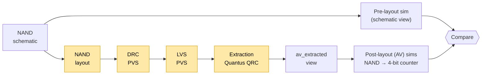

Only **`Kamalin/nand2`** has physical layout and extracted views. Higher-level AV runs can reuse those NAND parasitics; the interconnect between NAND instances remains schematic wiring.

## 1. NAND gate

The starting block uses two parallel PMOS devices and two series NMOS devices. Its output is low only when both inputs are high: **Y = ¬(A · B)**. Connecting the two inputs together also makes an inverter, reused in later stages.

<table>
<tr><th>Transistor-level NAND schematic</th><th>Reusable NAND symbol</th></tr>
<tr>
<td width="50%"><a href="schematic/NAND.png">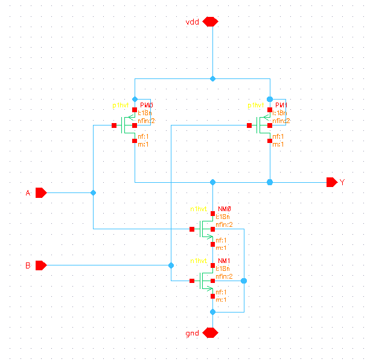</a></td>
<td width="50%"><a href="schematic/NAND_Symbol.png"></a></td>
</tr>
</table>

<details>
<summary>Testbench and ADE setup</summary>

<table>
<tr><th>NAND testbench</th><th>ADE transient and DC analysis setup</th></tr>
<tr>
<td width="50%"><a href="schematic/NAND_TestBench.png"></a></td>
<td width="50%"><a href="assets/Screenshots/NAND_Simulation.png">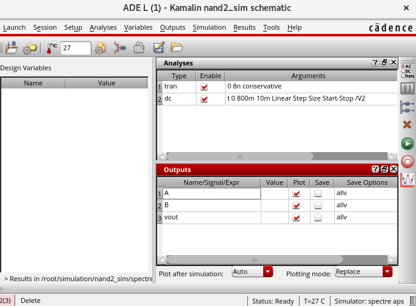</a></td>
</tr>
</table>

</details>

The [testbench](schematic/NAND_TestBench.png) shows a 0.8 V supply, 0–0.8 V pulse sources, a displayed rise-time setting of 10 ps, and no explicit output load. The [ADE screenshot](assets/Screenshots/NAND_Simulation.png) records an 8 ns transient analysis and a DC sweep of `/V2` from 0 to 800 mV in 10 mV steps at 27 °C. These are saved settings, not a portable ADE state.

**Transient response:** compare inputs A and B with the output, using the signal labels because the trace order changes between exports.

<table>
<tr><th>Schematic simulation</th><th>AV / extracted-view simulation</th></tr>
<tr>
<td width="50%"><a href="assets/readme/nand.png"></a></td>
<td width="50%"><a href="assets/readme/nand-av.png"></a></td>
</tr>
</table>

[Schematic PDF](results/NAND.pdf) · [AV PDF](results/NAND%28AV%29.pdf)

<details>
<summary>Additional NAND plots: DC response and CAP exports</summary>

**DC response with B held low**

The saved DC pages sweep A from 0 to 800 mV with B at 0 V, so the output stays near 800 mV. They do not characterize a full NAND switching transfer curve or noise margins.

<table>
<tr><th>NAND DC: schematic</th><th>NAND DC: AV</th></tr>
<tr>
<td width="50%"><a href="assets/readme/nand-dc.png"></a></td>
<td width="50%"><a href="assets/readme/nand-av-dc.png"></a></td>
</tr>
</table>

**Additional exports labeled NAND_CAP**

<table>
<tr><th>Schematic simulation</th><th>AV / extracted-view simulation</th></tr>
<tr>
<td width="50%"><a href="assets/readme/nand_cap.png">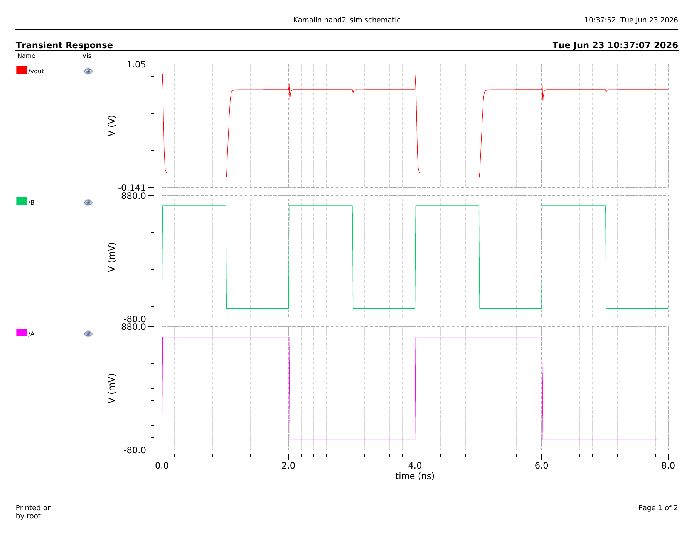</a></td>
<td width="50%"><a href="assets/readme/nand_cap-av.png"></a></td>
</tr>
</table>

<table>
<tr><th>NAND_CAP DC: schematic</th><th>NAND_CAP DC: AV</th></tr>
<tr>
<td width="50%"><a href="assets/readme/nand_cap-dc.png">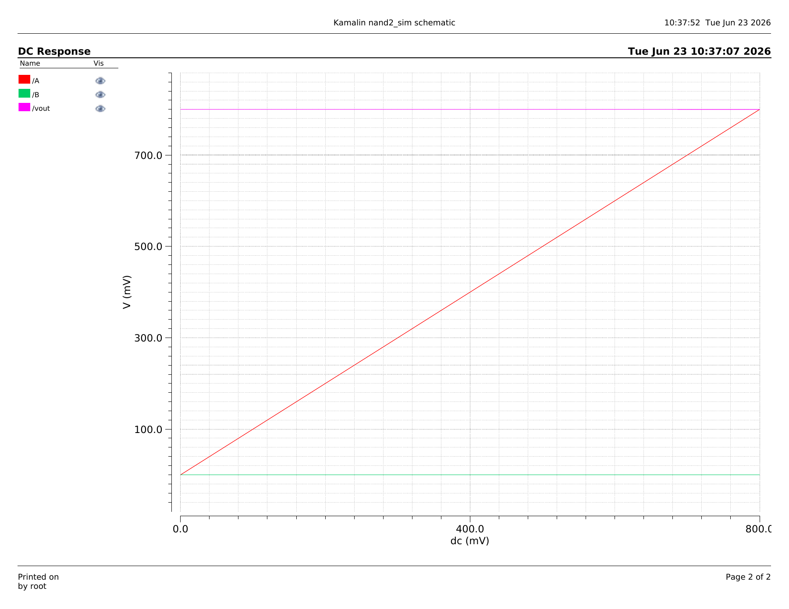</a></td>
<td width="50%"><a href="assets/readme/nand_cap-av-dc.png"></a></td>
</tr>
</table>

[Schematic PDF](results/NAND_CAP.pdf) · [AV PDF](results/NAND_CAP%28AV%29.pdf)

</details>

## 2. NAND layout and parasitics

The physical implementation is `Kamalin/nand2/layout`, with terminals `A`, `B`, `Y`, `vdd` and `gnd`. In the shown schematic, A controls the NMOS adjacent to Y and B controls the NMOS adjacent to ground. The layout screenshots show supply rails and body taps; check their connectivity when reproducing the design.

The NAND schematic is implemented as a physical layout. **DRC** checks the layout geometry against design rules; **LVS** checks that its devices and connections match the schematic. **Parasitic extraction** adds the resistance and capacitance introduced by the physical interconnect.

<table>
<tr><th>NAND physical layout</th><th>NAND extracted view</th></tr>
<tr>
<td width="50%"><a href="layout/NAND_Layout.png">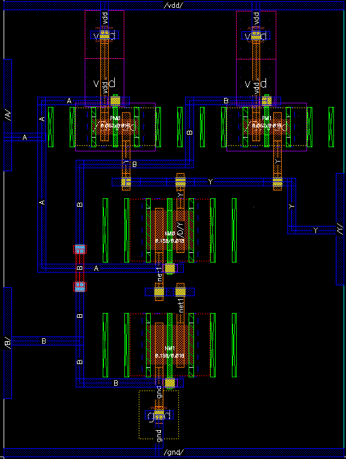</a></td>
<td width="50%"><a href="layout/NAND_av_extracted.png">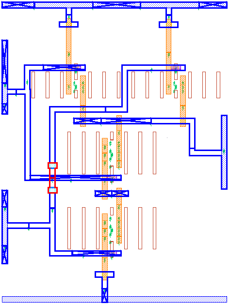</a></td>
</tr>
</table>

<details>
<summary>Alternate extracted view and recording</summary>

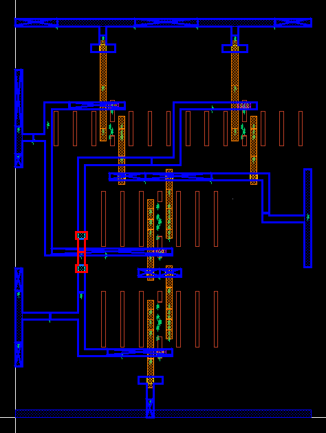

[Watch the extracted-view recording](assets/NAND_av_Extracted.webm)

</details>

| Check | Saved result | Evidence |
| --- | --- | --- |
| PVS DRC | **379 checks, 0 violations** | [DRC summary](verification/NAND_DRC_summary.sum) |
| PVS LVS | **MATCH**, 0 parameter mismatches | [LVS comparison](Kamalin/lvs_runs/nand2.rep.cls) |
| Quantus extraction | `av_extracted` created; 91 resistor and 90 capacitor instances | [Extraction log](Kamalin/lvs_runs/svdb/qrc.nand2.log) |

These are **archived June 22, 2026 results for nand2**, not a fresh verification of the current views. A full counter layout and counter-level DRC/LVS reports are not included. The DRC and LVS success screenshots still show tool/environment diagnostics; geometric DRC success and LVS MATCH do not mean the entire run log is free of errors or warnings.

The file named [NAND_LVS_summary.sum](verification/NAND_LVS_summary.sum) is an **ERC summary** with zero ERC checks and `erc2` marked “Not Executed!”; use the linked **LVS comparison** above for MATCH evidence. The Quantus log records completion, but also PDK initialization errors, missing-property and net-reference warnings, and **28 floating nets**. Their impact needs review in Cadence; see [known issues](KNOWN_ISSUES.md).

The `(AV)` filename convention identifies exports intended for the extracted-view flow. The saved session log records `av_extracted` in the switch-view list and successful historical simulations, but each PDF alone does not prove which device views or models were selected. Since the supplied extracted cell is `nand2`, higher-level circuits can include its parasitics by selecting `av_extracted` before `schematic` in the simulator view list. This does not capture wiring parasitics for a complete counter layout.

## 3. D latch

NAND gates form a gated latch that stores one bit. When **E = 1**, Q follows D; when **E = 0**, Q holds its previous value. The complementary output is labeled Q′.


<details>
<summary>D-latch symbol and testbench</summary>

<table>
<tr><th>D-latch symbol</th><th>D-latch testbench</th></tr>
<tr>
<td width="50%"><a href="schematic/D-Latch_Symbol.png"></a></td>
<td width="50%"><a href="schematic/D-Latch_TestBench.png">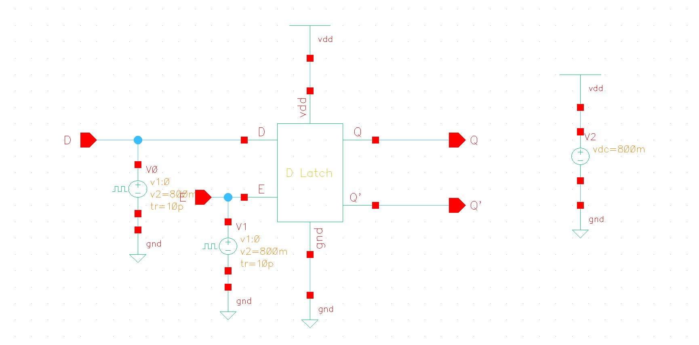</a></td>
</tr>
</table>

</details>

**What to look for:** Q follows D during the enabled interval and remains steady while the latch is closed.

<table>
<tr><th>Schematic simulation</th><th>AV / extracted-view simulation</th></tr>
<tr>
<td width="50%"><a href="assets/readme/dlatch.png">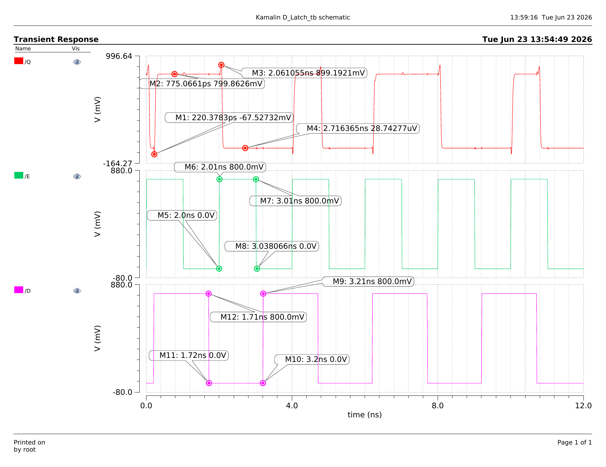</a></td>
<td width="50%"><a href="assets/readme/dlatch-av.png">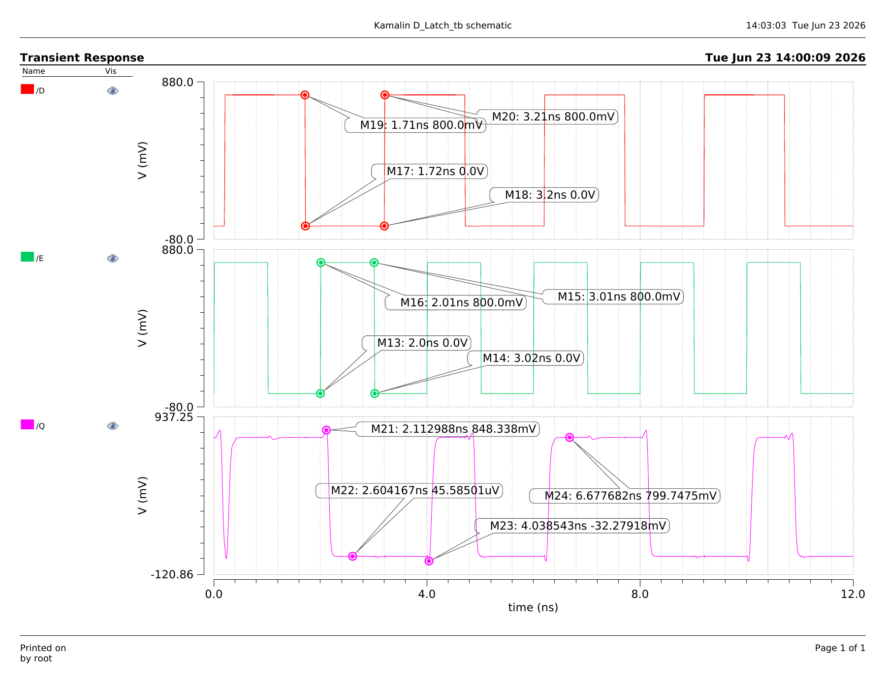</a></td>
</tr>
</table>

[Schematic PDF](results/Dlatch.pdf) · [AV PDF](results/Dlatch%28AV%29.pdf)

## 4. Master-slave D flip-flop

Two D latches operate on opposite clock phases. The master receives CLK and the slave receives its inverse, generated with a NAND gate. This arrangement transfers the stored value to Q on the **falling clock edge**.


<details>
<summary>DFF symbol and testbench</summary>

<table>
<tr><th>Master–slave DFF symbol</th><th>Master–slave DFF testbench</th></tr>
<tr>
<td width="50%"><a href="schematic/MS_Symbol.png">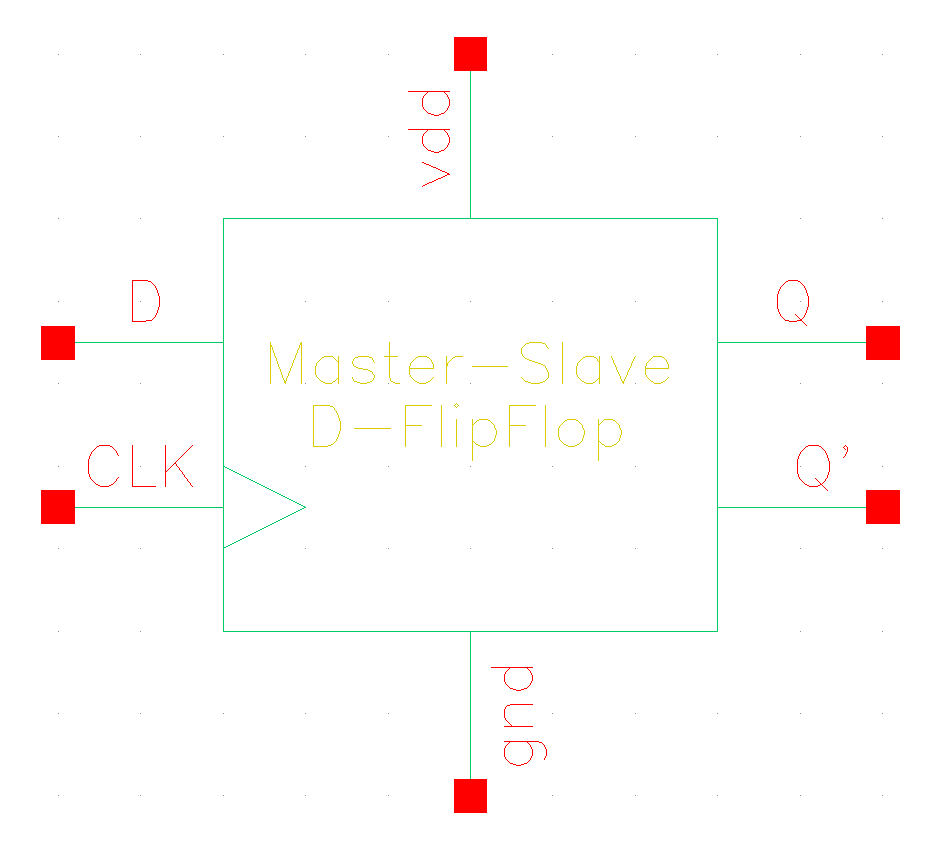</a></td>
<td width="50%"><a href="schematic/MS_TestBench.png"></a></td>
</tr>
</table>

</details>

**What to look for:** Q updates after the active clock edge, with propagation delay visible in the analog waveform.

<table>
<tr><th>Schematic simulation</th><th>AV / extracted-view simulation</th></tr>
<tr>
<td width="50%"><a href="assets/readme/ms_dff.png"></a></td>
<td width="50%"><a href="assets/readme/ms_dff-av.png"></a></td>
</tr>
</table>

[Schematic PDF](results/MS_DFF.pdf) · [AV PDF](results/MS_DFF%28AV%29.pdf)

## 5. T flip-flop

A NAND-based XOR network feeds the D flip-flop: **D = T ⊕ Q**. With **T = 0**, the stored bit holds; with **T = 1**, it toggles on each active clock edge. A continuously enabled T flip-flop divides the clock frequency by two.


<details>
<summary>TFF symbol and testbench</summary>

<table>
<tr><th>T flip-flop symbol</th><th>T flip-flop testbench</th></tr>
<tr>
<td width="50%"><a href="schematic/T-FF_Symbol.png"></a></td>
<td width="50%"><a href="schematic/T-FF_TestBench.png"></a></td>
</tr>
</table>

</details>

**What to look for:** compare T, CLK and Q to identify hold and toggle intervals.

<table>
<tr><th>Schematic simulation</th><th>AV / extracted-view simulation</th></tr>
<tr>
<td width="50%"><a href="assets/readme/tff.png"></a></td>
<td width="50%"><a href="assets/readme/tff-av.png"></a></td>
</tr>
</table>

[Schematic PDF](results/TFF.pdf) · [AV PDF](results/TFF%28AV%29.pdf)

## 6. Four-bit counter

Four T flip-flops provide outputs **Q3 Q2 Q1 Q0**, with Q0 as the least significant bit. A four-bit binary up-counter cycles through 16 states, from `0000` to `1111`, then wraps around.


*Supplied counter schematic: the common clock connects all four flip-flops. NAND logic generates the toggle enables for the upper bits.*

| Output | Toggle enable in the shown circuit | Ideal output frequency |
| --- | --- | --- |
| Q0 | T0 = 1 | fCLK / 2 |
| Q1 | T1 = Q0 | fCLK / 4 |
| Q2 | T2 = Q0 · Q1 | fCLK / 8 |
| Q3 | T3 = Q0 · Q1 · Q2 | fCLK / 16 |

An asynchronous ripple counter instead clocks each later flip-flop from the preceding stage's output, with its toggle input held high. The clock connections determine the topology, regardless of the cell name.
<table>
<tr><th>Schematic simulation</th><th>AV / extracted-view simulation</th></tr>
<tr>
<td width="50%"><a href="assets/readme/asynchronous_4bit_counter.png">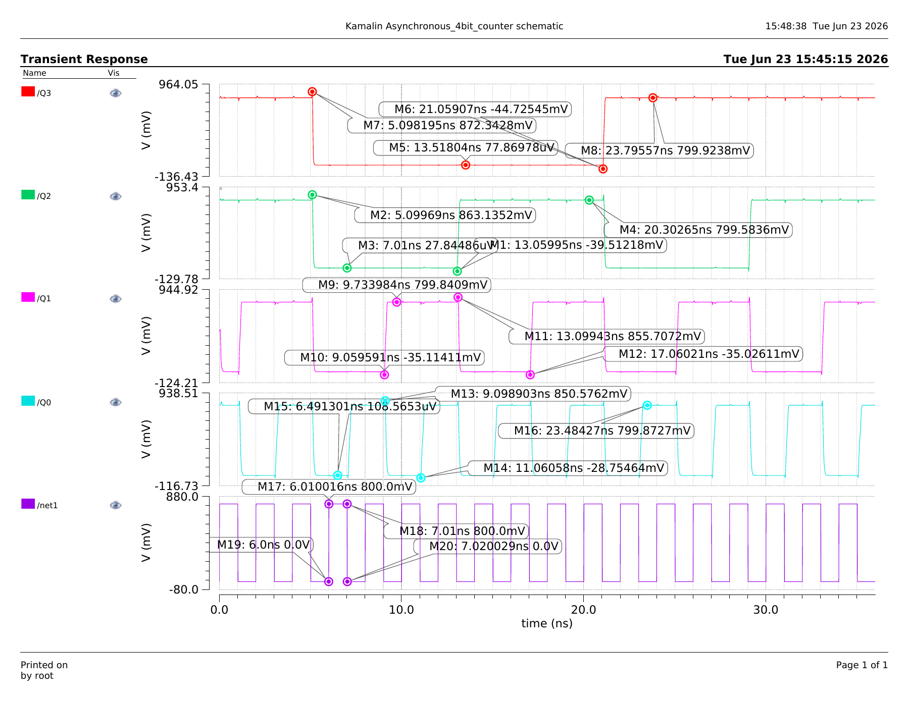</a></td>
<td width="50%"><a href="assets/readme/asynchronous_4bit_counter-av.png"></a></td>
</tr>
</table>

[Schematic PDF](results/Asynchronous_4bit_counter.pdf) · [AV PDF](results/Asynchronous_4bit_counter%28AV%29.pdf)

Read the waveform labels rather than their vertical position: the two exports use different trace ordering. Inspect the changing bit periods and transition settling. A known `0000` startup state requires an initialization or reset setup; the shown schematic does not expose a reset input.

## Schematic and AV comparison

Use the paired PDFs and PNG previews above to compare the same named signals. **The earlier draft reversed the direction of several overshoot comparisons relative to the current filenames.** The table below instead transcribes selected visible output markers from the saved PDFs; it does not claim global maxima or a controlled measurement of extraction effects.

| Output | Plain-filename PDF: annotated voltage | `(AV)` PDF: annotated voltage |
| --- | --- | --- |
| NAND `/vout` | [1056.95 mV, M28](results/NAND.pdf) | [974.098 mV, M5](results/NAND%28AV%29.pdf) |
| D latch `/Q` | [899.1921 mV, M3](results/Dlatch.pdf) | [848.338 mV, M21](results/Dlatch%28AV%29.pdf) |
| Master–slave DFF `/Q` | [898.0629 mV, M36](results/MS_DFF.pdf) | [838.7127 mV, M25](results/MS_DFF%28AV%29.pdf) |
| TFF `/Q` | [872.3903 mV, M2](results/TFF.pdf) | [829.3358 mV, M22](results/TFF%28AV%29.pdf) |
| Counter `/Q3` | [872.3428 mV, M7](results/Aynchronous_4bit_counter.pdf) | [833.6531 mV, M21](results/Aynchronous_4bit_counter%28AV%29.pdf) |

At the shown 800 mV supply, the NAND samples correspond to 256.95 mV and 174.098 mV above VDD, respectively. The extra decimal places reproduce the annotations; they are not an accuracy specification. Marker times, trace order and run durations vary. The counter plots also show different transition alignment (for example, Q3 falls near 5 ns in the plain-filename export and near 1 ns in the AV export), so the initial states must be checked before comparing count sequences. Raw waveforms and complete paired run configurations are not bundled, so these values do not establish full functional equivalence, worst-case excursions, or that layout alone caused every difference. The earlier “roughly doubles the spikes” conclusion is not supported by the files as named.

For a repeatable comparison, keep the device variant, model corner, supply, temperature, stimulus, load, analysis settings and initial state fixed; confirm the generated netlist selects the intended NAND view. Measure propagation delays at defined thresholds and compare the count after transitions settle. The shown counter is synchronous, so its behavior should not be described as clock ripple accumulating from stage to stage.

The `NAND_CAP` exports are retained as additional runs. Their filename alone does not establish the capacitor value or configuration; those details need to accompany a reproducible testbench.

## Troubleshooting from saved screenshots

The screenshots document issues encountered during development. The checks below follow the visible Cadence messages and saved reports. Any chat advice visible alongside the application is contextual material, not proof that a proposed fix was applied. Historical success screenshots do not establish that every warning was resolved.

### PVS run setup

| Symptom / screenshot | What to check |
| --- | --- |
| [Empty Run Directory](assets/Screenshots/PVS_22.20-64b_DRC_Run_Submission_Form-Run_Directory.png) | Set a writable local run directory for the current design. Saved `/root/...` paths belong to the original machine. |
| [“At least one readable file must be specified”](assets/Screenshots/PVS_22.20-64b_DRC_Run_Submission_Form-At_least_one_readable_file_must_be_specified.png) | Select the installed PDK's readable DRC rule file. |
| [Blank Rule Set](assets/Screenshots/PVS_22.20-64b_DRC_Run_Submission_Form-Rule_Set.png) and [selection-list error](assets/Screenshots/PVS_22.20-64b_DRC_Run_Submission_Form-Run_Directory-Errors_Found.png) | Use the PVS technology mapping and a valid rule-set choice. The later accepted form shows `pvtech.lib`, technology `cds_ff_mpt_pvs`, rule set `default`, and DRC deck `pvs/pvlDRC.rul`. Resolve all paths against your installed PDK. |
| [Syntax errors after loading a preset](assets/Screenshots/PVS_22.20-64b_DRC_Run_Submission_Form-Run_Directory-Errors.png) | The shown `.vipvs_preset` was rejected in that configuration field. Do not treat it as a verified fix or use a DRC/LVS deck interchangeably. |

<details>
<summary>Accepted PVS submission settings</summary>

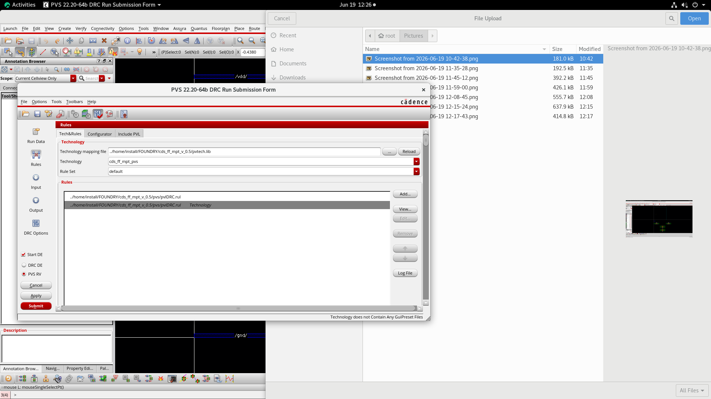

This records accepted form settings, not completion of DRC. The saved DRC summary provides the check results.

</details>

### LiAct width violations

The [layout overview](assets/Screenshots/DRC_Problem-LiAct_Width_1.png), [marked layout and error list](assets/Screenshots/DRC_Problem-LiAct_Width_2.png) and [rule details](assets/Screenshots/DRC_Problem-LiAct_Width_3.png) show **three `LIACT.W.1` violations**. The displayed rule allows widths `0.03`, `0.04`, `0.05`; that message does not show units. Inspect each marked shape, follow the installed PDK's rule and units, and rerun DRC. The screenshots do not record the exact geometry edits made between the failing and passing runs.

<details>
<summary>Saved DRC success screenshot</summary>

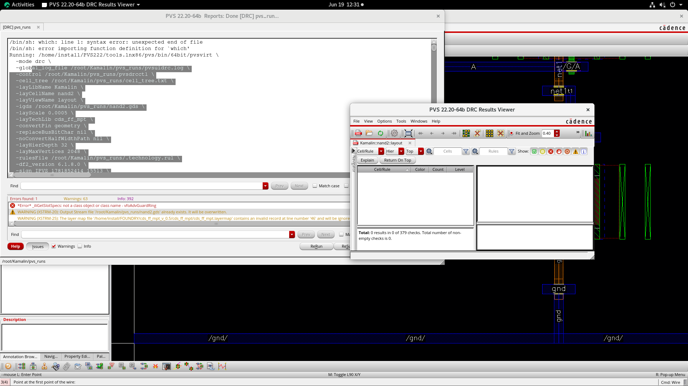

The results viewer shows **0 results across 379 checks**, while the run panel also shows **1 error and 63 warnings**. Visible diagnostics include PDK guard-ring initialization, shell function import and stream layer-map messages. Review those separately from geometric rule violations.

</details>

### LVS pins, labels and connectivity

| Evidence | What to check |
| --- | --- |
| [Two shorts/opens](assets/Screenshots/LVS_Problem-Unmatched_Schematic_Pin_Labels_1.png), [one remaining shorts/opens entry](assets/Screenshots/LVS_Problem-Unmatched_Schematic_Pin_Labels_2.png) and [five missing layout pins](assets/Screenshots/LVS_Problem-Unmatched_Schematic_Pin_Labels_3.png) | Confirm layout terminals `A`, `B`, `Y`, `vdd` and `gnd` exist and match the schematic. Inspect opens/shorts separately; correcting a name alone does not establish connectivity. |
| [Layout view](assets/Screenshots/LVS_Problem-Unmatched_Schematic_Pin_Labels_4.png) and [UNATTACHED PORT LABEL](assets/Screenshots/LVS_Problem-Unmatched_Port_Label.png) | The warning identifies `gnd` on `M1_pin`. Check that its pin/label geometry uses the recognized layer and overlaps the intended connected conductor. |
| [Displaced ground pin during Move](assets/Screenshots/Pin_out_of_Die_Area.png) | Check pin geometry alignment with the ground rail. The image alone does not prove a die-area rule violation. |

Use consistent supply names and connectivity throughout the hierarchy; the archived NAND netlist uses local `vdd` and `gnd` terminals. Check body-tie routing to the intended supply nets. After schematic edits, run **Check and Save**, then regenerate the netlist; the session log records earlier stale-schematic failures followed by successful runs.

<details>
<summary>Saved LVS success screenshot</summary>

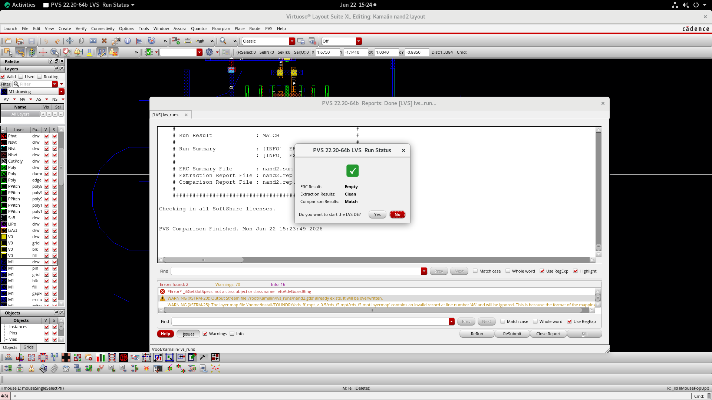

The comparison shows **MATCH**, while the run panel shows **2 errors and 70 warnings**. The viewer's “ERC Empty” status is not evidence of a completed ERC sweep; the saved ERC summary records zero executed checks.

</details>

### Extraction and editor issues

- **Quantus entry point:** the [menu screenshot](assets/Screenshots/Quantus_Dropdown_Menu.png) shows **Run PVS - Quantus**. The [QRC log](Kamalin/lvs_runs/svdb/qrc.nand2.log) supplies completion evidence. Configure the required LVS/extraction data with the installed PDK's flow; a menu screenshot alone does not establish the cause of a missing extraction file.
- **Missing parasitic models:** saved ADE commands reference `/root/rcx_models.scs`, but this file is not included. If `cmodel` or `rmodel` cannot be resolved, identify the actual models required by the generated netlist and your PDK, and add the correct model files in ADE. No verified replacement “two-line model file” is supplied here.
- **Assura:** the session log records an Assura 20.1 / layout editor 6.1.8 version mismatch. The documented successful checks use PVS; the log does not establish blanket incompatibility of Assura with every installation of this PDK.
- **Outline not moving:** the [screenshot](assets/Screenshots/Outline_not_moving.png) shows Stretch active, but does not identify the selected object's type or root cause. Check the object and selection filters in the editor. A specific fix cannot be confirmed from this image.

## Repository guide

| Folder | Contents |
| --- | --- |
| [`Kamalin/`](Kamalin/) | Editable Virtuoso/OpenAccess cell views and verification runs |
| [`schematic/`](schematic/) | Schematics, symbols and testbench screenshots |
| [`layout/`](layout/) | NAND layout and extracted-view screenshots |
| [`results/`](results/) | Twelve waveform PDFs (16 pages); `(AV)` labels the intended extracted-view exports |
| [`verification/`](verification/) | Copied NAND DRC summary and ERC summary (despite the latter's LVS filename) |
| [`assets/Screenshots/`](assets/Screenshots/) | ADE setup, troubleshooting and saved success screenshots |
| [`assets/`](assets/) | Counter PDF and extracted-view video |
| [`assets/readme/`](assets/readme/) | PNG previews rendered from all 16 pages of the waveform PDFs |

## Open the project

Clone the repository, or use your existing checkout:

```bash
git clone https://github.com/XEMACS-666/Virtuoso-4bit-Async-Counter.git
cd Virtuoso-4bit-Async-Counter
```

1. Use a configured Cadence Virtuoso installation with Spectre, PVS and Quantus, plus the matching `cds_ff_mpt` PDK and `analogLib`. The archived verification runs used PVS 22.20. Match your installation to the PDK requirements.
2. Register the supplied library in your local `cds.lib`, replacing the example path:

   ```text
   DEFINE Kamalin /absolute/path/to/Virtuoso-4bit-Async-Counter/Kamalin
   ```

3. Launch Virtuoso from the directory containing your configured `cds.lib`, then use Library Manager → `Kamalin`. Open `nand2` and choose its `schematic`, `layout` or `av_extracted` view. Explore the cells in order: `nand2` → `D_Latch` → `Master_Slave_DFF` → `Toggle_FF` → `Asynchronous_4bit_counter`.
4. Use `nand2_sim`, `D_Latch_tb`, `Master_Slave_DFF_tb` and `Toggle_FF_tb` for block simulations. The counter cell includes its stimulus sources.
5. Recreate the ADE model and analysis settings for your installation. For parasitic-aware runs, place `av_extracted` before `schematic` in the switch-view list and confirm which view is selected in the generated netlist.
6. To repeat physical verification, run PVS DRC/LVS on `nand2/layout`, then Quantus extraction with your installed technology files.

The repository contains design views and saved results. The PDK, simulator licenses, raw waveforms, referenced local parasitic-model files and a portable ADE run configuration are not bundled. Saved run files contain paths from the original machine, so create locally configured runs instead of executing archived launch scripts unchanged.

## Follow-up work

- [ ] Reconcile the synchronous counter screenshot with the historical asynchronous repository/cell names before renaming design cells.
- [ ] Reconcile HVT screenshot labels with SVT verification netlists and archive the exact model/view configuration used for each plot.
- [ ] Review the archived extraction diagnostics and floating nets, then rerun DRC/LVS/extraction and simulation in the configured Cadence environment.
- [ ] Save portable ADE settings and the required user-authored model definitions or setup instructions; record model corner, temperature, stimulus, load and initial state.
- [ ] Measure `tpLH` / `tpHL` for A → Y and B → Y with one input held high while the other switches. The exported NAND input edges coincide at some transitions, so those events do not isolate each path.
- [ ] Compare input-to-output timing for the Y-side versus ground-side NMOS gate assignments.
- [ ] Add a realistic driver → DUT → load testbench and document the `NAND_CAP` configuration.
- [ ] Add a reset or documented initialization method if a deterministic `0000` startup state is required.

See [KNOWN_ISSUES.md](KNOWN_ISSUES.md) for the documentation repairs and unresolved evidence gaps. The documentation review did not rerun Cadence simulations or modify the circuit views.

## Author

**XEMACS**
