# 4-Bit Counter in Cadence Virtuoso

**From a transistor-level NAND gate to a four-bit counter.**

This project builds reusable logic blocks in Cadence Virtuoso, verifies the NAND layout with PVS, extracts its parasitic resistance and capacitance with Quantus, and compares schematic and extracted-view simulations through the design hierarchy.

**Design journey:** NAND → D latch → master–slave D flip-flop → T flip-flop → 4-bit counter

> **Counter naming:** This repository is named `Virtuoso-4bit-Async-Counter`, and the top cell is `Asynchronous_4bit_counter`. However, the supplied counter screenshot shows a common clock and toggle-enable logic: a **synchronous** counter topology. The original names are preserved; the screenshot is identified accurately below.

[NAND](#1-nand-gate) · [Layout & verification](#2-nand-layout-and-parasitics) · [D latch](#3-d-latch) · [D flip-flop](#4-master-slave-d-flip-flop) · [T flip-flop](#5-t-flip-flop) · [Counter](#6-four-bit-counter) · [Open the project](#open-the-project)

## At a glance

| Item | Details |
| --- | --- |
| Design library | `Kamalin` |
| Environment | Cadence Virtuoso, Spectre/ADE, PVS and Quantus |
| Technology library | `cds_ff_mpt`, as recorded in the saved logs |
| Supply shown in testbenches | 0.8 V |
| Physical implementation included | `nand2/layout` and `nand2/av_extracted` |
| Simulation exports | NAND, D latch, master–slave DFF, TFF and four-bit counter |

The original project description mentions HVT1 and LVT1. The archived NAND LVS netlist uses **N1SVT/P1SVT** models; separate HVT/LVT comparison results are not included. Device variants should therefore be checked against the specific view and run being used.

## 1. NAND gate

The starting block uses two parallel PMOS devices and two series NMOS devices. Its output is low only when both inputs are high: **Y = ¬(A · B)**. Connecting the two inputs together also makes an inverter, reused in later stages.

<table>
<tr><th>Transistor-level NAND schematic</th><th>Reusable NAND symbol</th></tr>
<tr>
<td width="50%"><a href="schematic/NAND.png"></a></td>
<td width="50%"><a href="schematic/NAND_Symbol.png">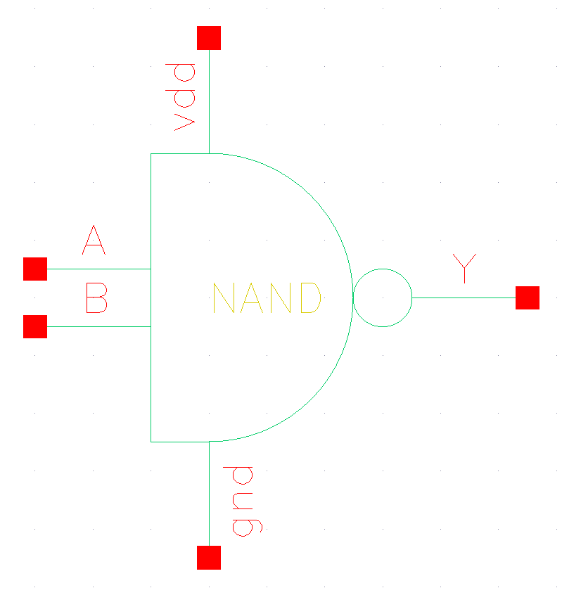</a></td>
</tr>
</table>

<details>
<summary>Testbench and ADE setup</summary>

<table>
<tr><th>NAND testbench</th><th>ADE transient and DC analysis setup</th></tr>
<tr>
<td width="50%"><a href="schematic/NAND_TestBench.png">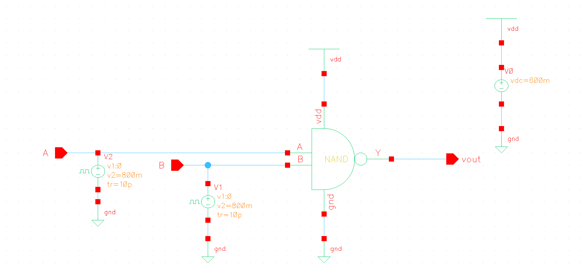</a></td>
<td width="50%"><a href="assets/Screenshot%20from%202026-06-23%2010-19-01.png"></a></td>
</tr>
</table>

</details>

**Transient response:** compare inputs A and B with the output, using the signal labels because the trace order changes between exports.

<table>
<tr><th>Schematic simulation</th><th>AV / extracted-view simulation</th></tr>
<tr>
<td width="50%"><a href="assets/readme/nand.png">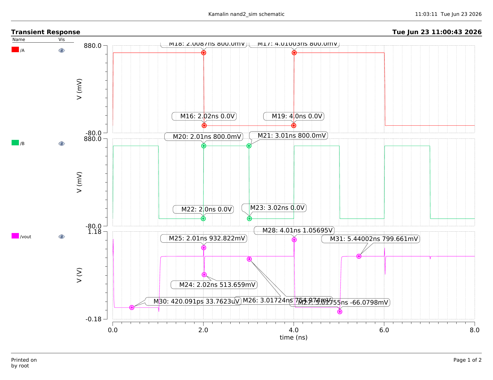</a></td>
<td width="50%"><a href="assets/readme/nand-av.png">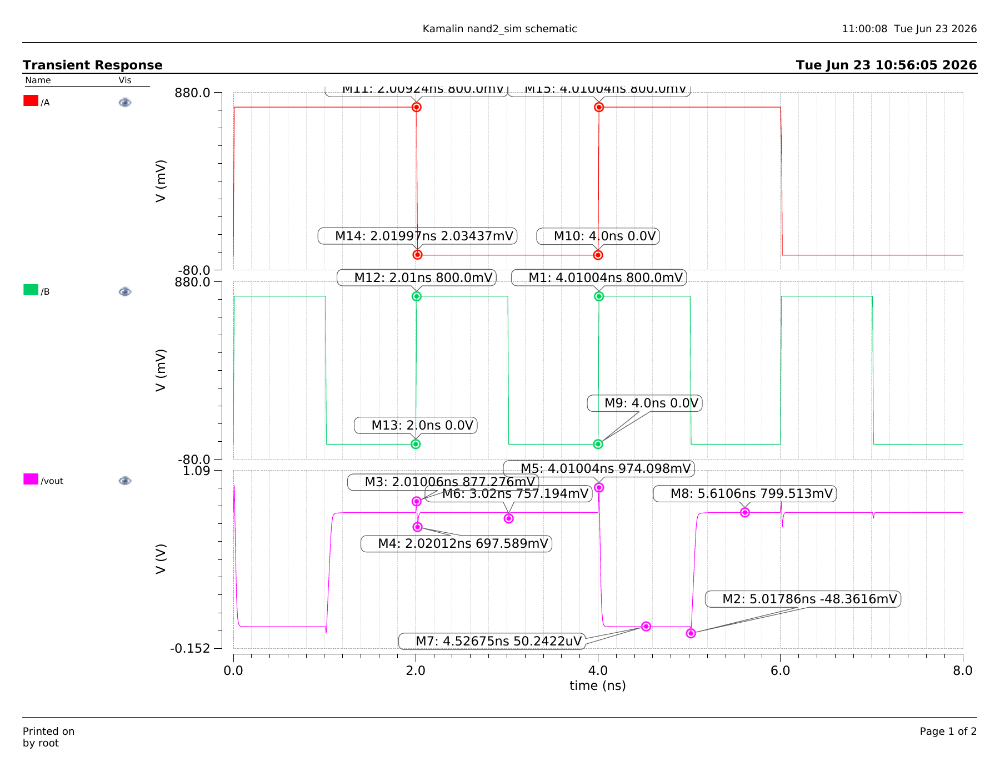</a></td>
</tr>
</table>

[Schematic PDF](output/NAND.pdf) · [AV PDF](output/NAND%28AV%29.pdf)

<details>
<summary>Additional NAND plots: DC response and CAP exports</summary>

**DC response**

<table>
<tr><th>NAND DC: schematic</th><th>NAND DC: AV</th></tr>
<tr>
<td width="50%"><a href="assets/readme/nand-dc.png"></a></td>
<td width="50%"><a href="assets/readme/nand-av-dc.png"></a></td>
</tr>
</table>

**Additional exports labeled NAND_CAP**

<table>
<tr><th>Schematic simulation</th><th>AV / extracted-view simulation</th></tr>
<tr>
<td width="50%"><a href="assets/readme/nand_cap.png"></a></td>
<td width="50%"><a href="assets/readme/nand_cap-av.png">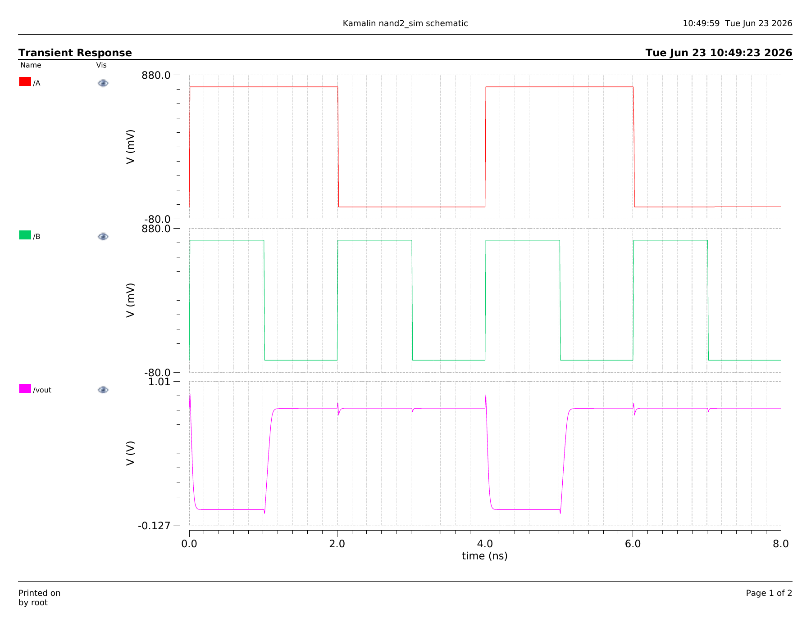</a></td>
</tr>
</table>

<table>
<tr><th>NAND_CAP DC: schematic</th><th>NAND_CAP DC: AV</th></tr>
<tr>
<td width="50%"><a href="assets/readme/nand_cap-dc.png"></a></td>
<td width="50%"><a href="assets/readme/nand_cap-av-dc.png"></a></td>
</tr>
</table>

[Schematic PDF](output/NAND_CAP.pdf) · [AV PDF](output/NAND_CAP%28AV%29.pdf)

</details>

## 2. NAND layout and parasitics

The NAND schematic is implemented as a physical layout. **DRC** checks the layout geometry against design rules; **LVS** checks that its devices and connections match the schematic. **Parasitic extraction** adds the resistance and capacitance introduced by the physical interconnect.

<table>
<tr><th>NAND physical layout</th><th>NAND extracted view</th></tr>
<tr>
<td width="50%"><a href="layout/NAND_Layout.png"></a></td>
<td width="50%"><a href="layout/NAND_av_extracted.png"></a></td>
</tr>
</table>

<details>
<summary>Alternate extracted view and recording</summary>


[Watch the extracted-view recording](assets/NAND_av_Extracted.webm)

</details>

| Check | Saved result | Evidence |
| --- | --- | --- |
| PVS DRC | **379 checks, 0 violations** | [DRC summary](Kamalin/pvs_runs/nand2.sum) |
| PVS LVS | **MATCH**, 0 parameter mismatches | [LVS comparison](Kamalin/lvs_runs/nand2.rep.cls) |
| Quantus extraction | `av_extracted` created; 91 resistor and 90 capacitor instances | [Extraction log](Kamalin/lvs_runs/svdb/qrc.nand2.log) |

These physical-verification results apply to **nand2**. A full counter layout and counter-level DRC/LVS reports are not included. The extraction log records completion along with PDK-loading and net-reference warnings.

The `(AV)` exports document simulations using the extracted-view flow. Since the supplied extracted cell is `nand2`, higher-level circuits can include its parasitics by selecting `av_extracted` before `schematic` in the simulator view list. This does not capture wiring parasitics for a complete counter layout.

## 3. D latch

NAND gates form a gated latch that stores one bit. When **E = 1**, Q follows D; when **E = 0**, Q holds its previous value. The complementary output is labeled Q′.

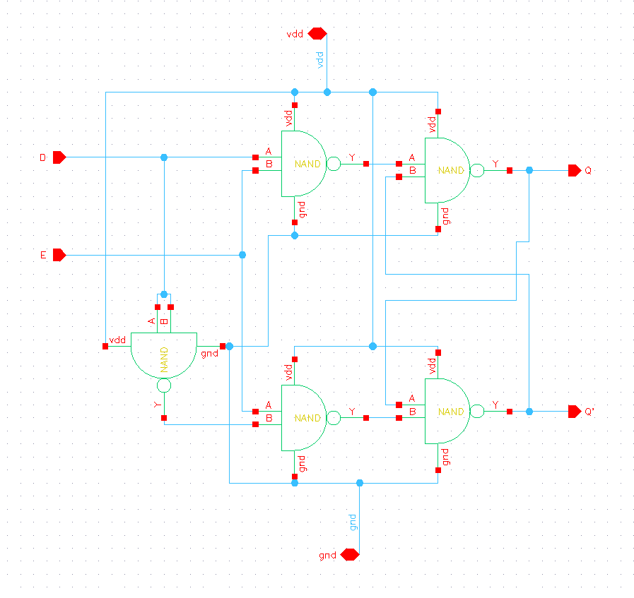

<details>
<summary>D-latch symbol and testbench</summary>

<table>
<tr><th>D-latch symbol</th><th>D-latch testbench</th></tr>
<tr>
<td width="50%"><a href="schematic/D-Latch_Symbol.png">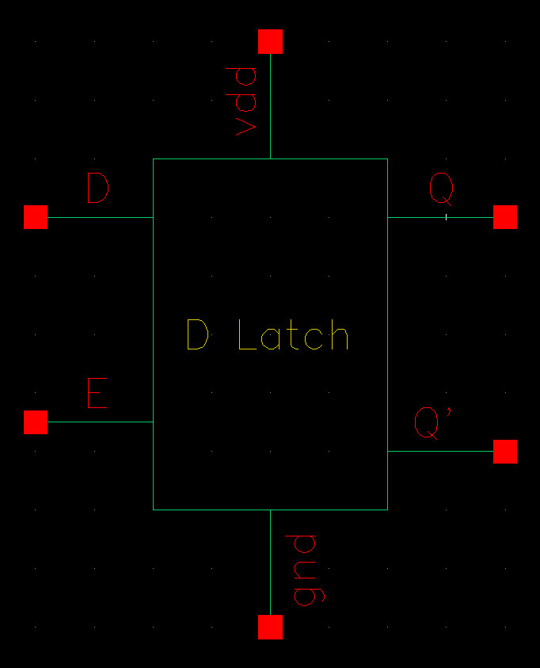</a></td>
<td width="50%"><a href="schematic/D-Latch_TestBench.png"></a></td>
</tr>
</table>

</details>

**What to look for:** Q follows D during the enabled interval and remains steady while the latch is closed.

<table>
<tr><th>Schematic simulation</th><th>AV / extracted-view simulation</th></tr>
<tr>
<td width="50%"><a href="assets/readme/dlatch.png"></a></td>
<td width="50%"><a href="assets/readme/dlatch-av.png"></a></td>
</tr>
</table>

[Schematic PDF](output/Dlatch.pdf) · [AV PDF](output/Dlatch%28AV%29.pdf)

## 4. Master–slave D flip-flop

Two D latches operate on opposite clock phases. The master receives CLK and the slave receives its inverse, generated with a NAND gate. This arrangement transfers the stored value to Q on the **falling clock edge**.

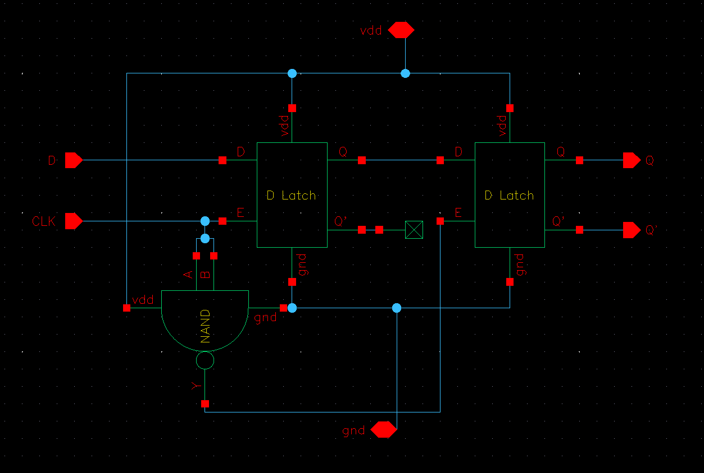

<details>
<summary>DFF symbol and testbench</summary>

<table>
<tr><th>Master–slave DFF symbol</th><th>Master–slave DFF testbench</th></tr>
<tr>
<td width="50%"><a href="schematic/MS_Symbol.png"></a></td>
<td width="50%"><a href="schematic/MS_TestBench.png">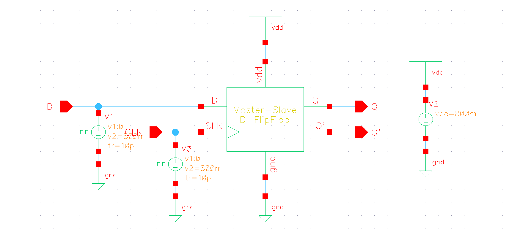</a></td>
</tr>
</table>

</details>

**What to look for:** Q updates after the active clock edge, with propagation delay visible in the analog waveform.

<table>
<tr><th>Schematic simulation</th><th>AV / extracted-view simulation</th></tr>
<tr>
<td width="50%"><a href="assets/readme/ms_dff.png">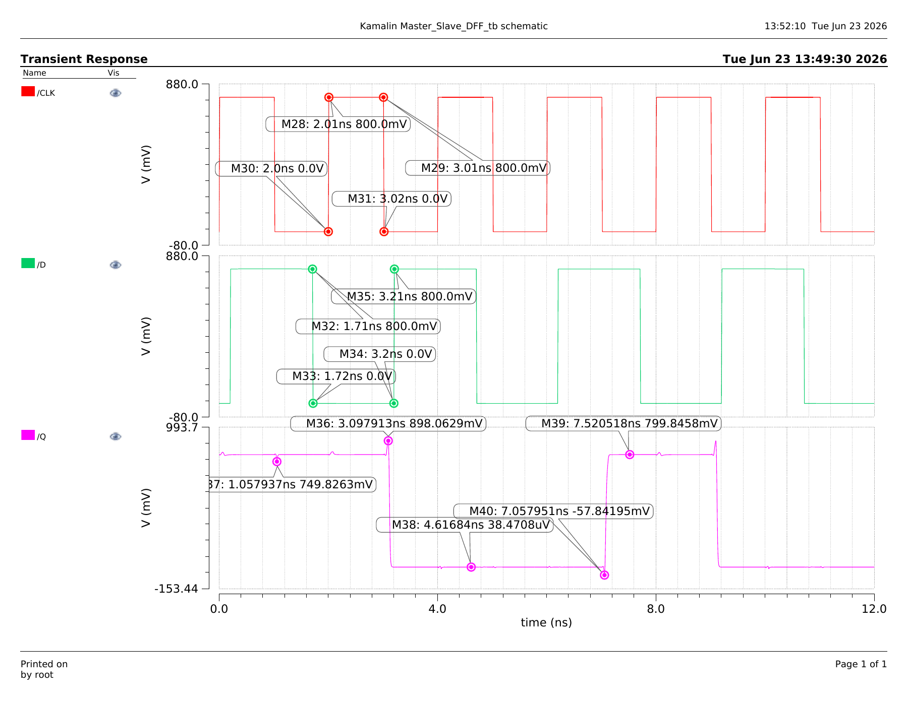</a></td>
<td width="50%"><a href="assets/readme/ms_dff-av.png">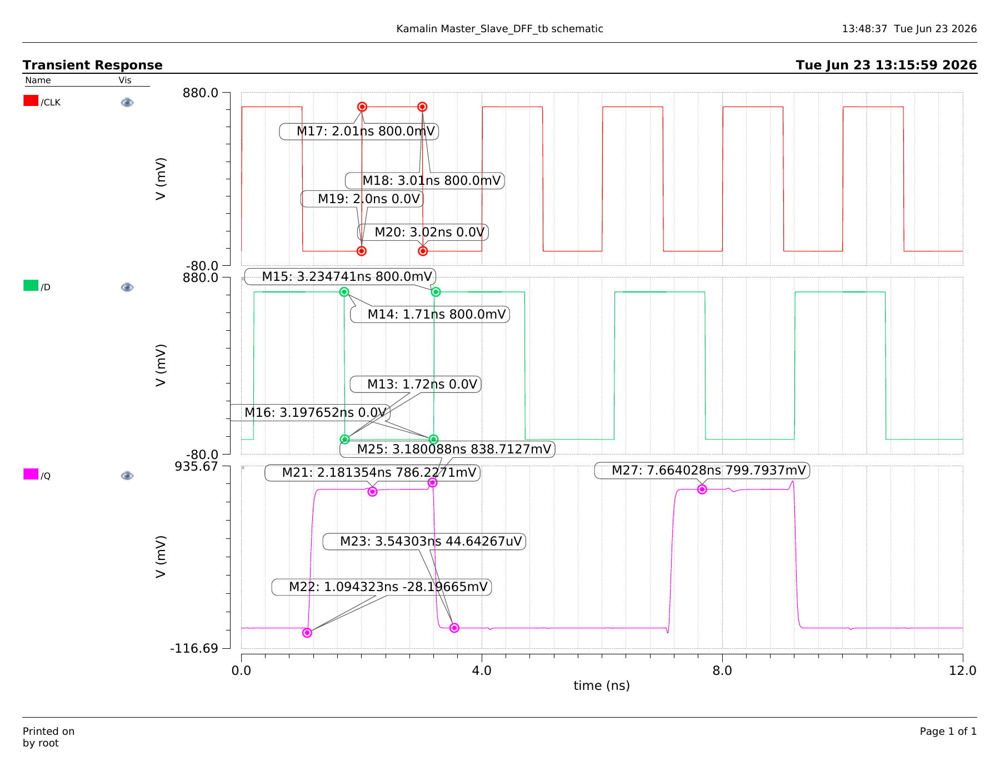</a></td>
</tr>
</table>

[Schematic PDF](output/MS_DFF.pdf) · [AV PDF](output/MS_DFF%28AV%29.pdf)

## 5. T flip-flop

A NAND-based XOR network feeds the D flip-flop: **D = T ⊕ Q**. With **T = 0**, the stored bit holds; with **T = 1**, it toggles on each active clock edge. A continuously enabled T flip-flop divides the clock frequency by two.

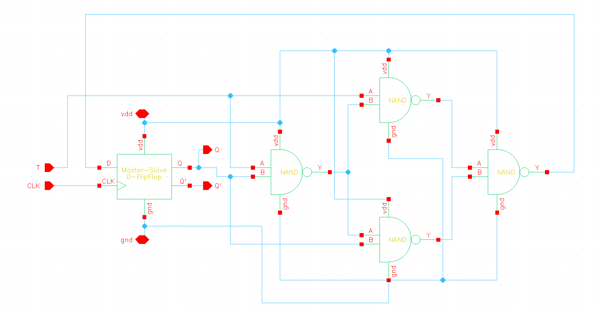

<details>
<summary>TFF symbol and testbench</summary>

<table>
<tr><th>T flip-flop symbol</th><th>T flip-flop testbench</th></tr>
<tr>
<td width="50%"><a href="schematic/T-FF_Symbol.png">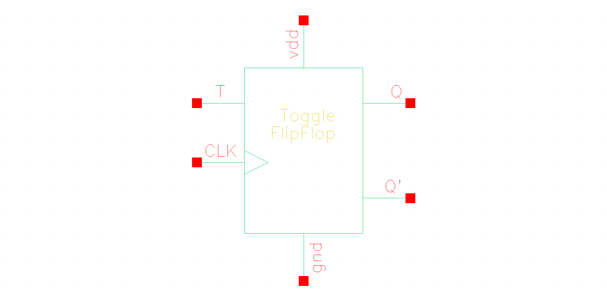</a></td>
<td width="50%"><a href="schematic/T-FF_TestBench.png">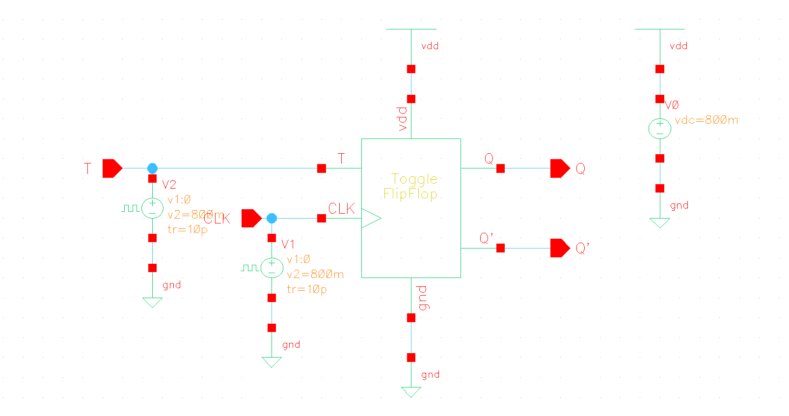</a></td>
</tr>
</table>

</details>

**What to look for:** compare T, CLK and Q to identify hold and toggle intervals.

<table>
<tr><th>Schematic simulation</th><th>AV / extracted-view simulation</th></tr>
<tr>
<td width="50%"><a href="assets/readme/tff.png">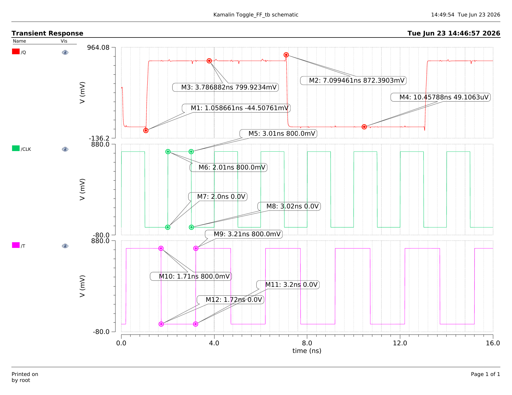</a></td>
<td width="50%"><a href="assets/readme/tff-av.png">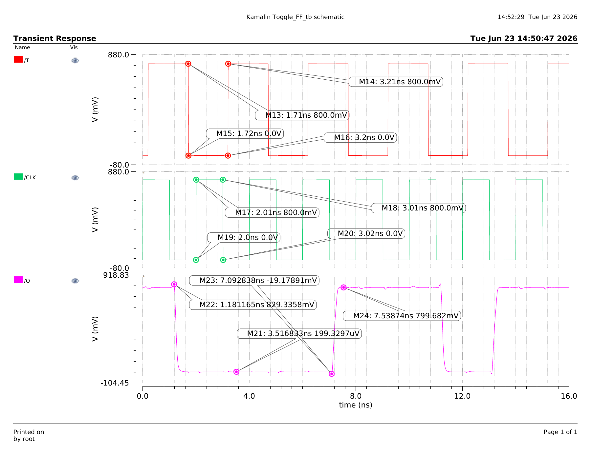</a></td>
</tr>
</table>

[Schematic PDF](output/TFF.pdf) · [AV PDF](output/TFF%28AV%29.pdf)

## 6. Four-bit counter

Four T flip-flops provide outputs **Q3 Q2 Q1 Q0**, with Q0 as the least significant bit. A four-bit binary up-counter cycles through 16 states, from `0000` to `1111`, then wraps around.

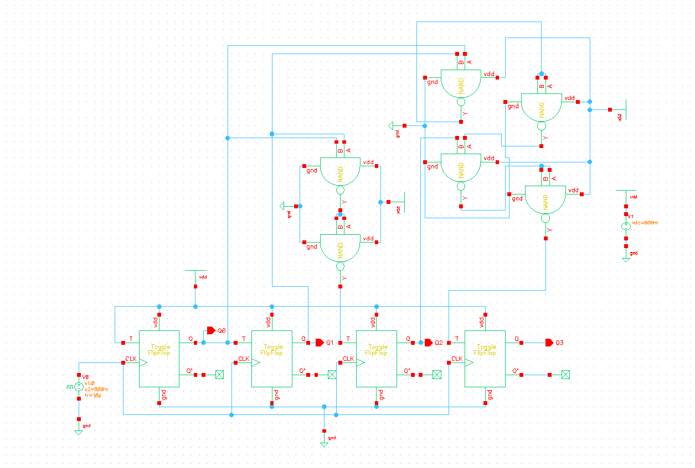

*Supplied counter schematic: the common clock connects all four flip-flops. NAND logic generates the toggle enables for the upper bits.*

| Output | Toggle enable in the shown circuit | Ideal output frequency |
| --- | --- | --- |
| Q0 | T0 = 1 | fCLK / 2 |
| Q1 | T1 = Q0 | fCLK / 4 |
| Q2 | T2 = Q0 · Q1 | fCLK / 8 |
| Q3 | T3 = Q0 · Q1 · Q2 | fCLK / 16 |

An asynchronous ripple counter instead clocks each later flip-flop from the preceding stage's output, with its toggle input held high. The clock connections determine the topology, regardless of the cell name.

**Counter waveforms — schematic simulation**


**Counter waveforms — AV / extracted-view simulation**

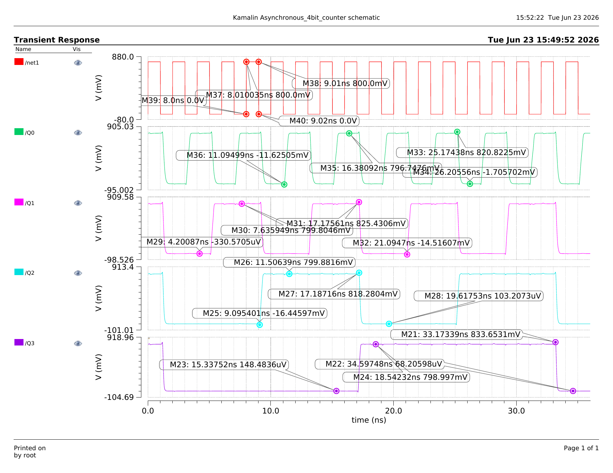

[Schematic PDF](output/Aynchronous_4bit_counter.pdf) · [AV PDF](output/Aynchronous_4bit_counter%28AV%29.pdf)

Read the waveform labels rather than their vertical position: the two exports use different trace ordering. Inspect the changing bit periods and transition settling. A known `0000` startup state requires an initialization or reset setup; the shown schematic does not expose a reset input.

## Repository guide

| Folder | Contents |
| --- | --- |
| [`Kamalin/`](Kamalin/) | Editable Virtuoso/OpenAccess cell views and verification runs |
| [`schematic/`](schematic/) | Schematics, symbols and testbench screenshots |
| [`layout/`](layout/) | NAND layout and extracted-view screenshots |
| [`output/`](output/) | Original waveform PDFs; `(AV)` identifies extracted-view exports |
| [`assets/`](assets/) | ADE screenshot and extracted-view video |
| [`assets/readme/`](assets/readme/) | PNG previews rendered from all 16 pages of the waveform PDFs |

## Open the project

1. Use a configured Cadence installation with the matching `cds_ff_mpt` technology library and `analogLib`.
2. Register the supplied library in your local `cds.lib`, replacing the example path:

   ```text
   DEFINE Kamalin /absolute/path/to/Virtuoso-4bit-Async-Counter/Kamalin
   ```

3. Open the cells in order: `nand2` → `D_Latch` → `Master_Slave_DFF` → `Toggle_FF` → `Asynchronous_4bit_counter`.
4. Use `nand2_sim`, `D_Latch_tb`, `Master_Slave_DFF_tb` and `Toggle_FF_tb` for block simulations. The counter cell includes its stimulus sources.
5. Recreate the ADE model and analysis settings for your installation. For parasitic-aware runs, place `av_extracted` before `schematic` in the switch-view list and confirm which view is selected in the generated netlist.
6. To repeat physical verification, run PVS DRC/LVS on `nand2/layout`, then Quantus extraction with your installed technology files.

The repository contains design views and saved results. The PDK, simulator licenses and a portable ADE run configuration are not bundled; saved run files also contain paths from the original machine.
